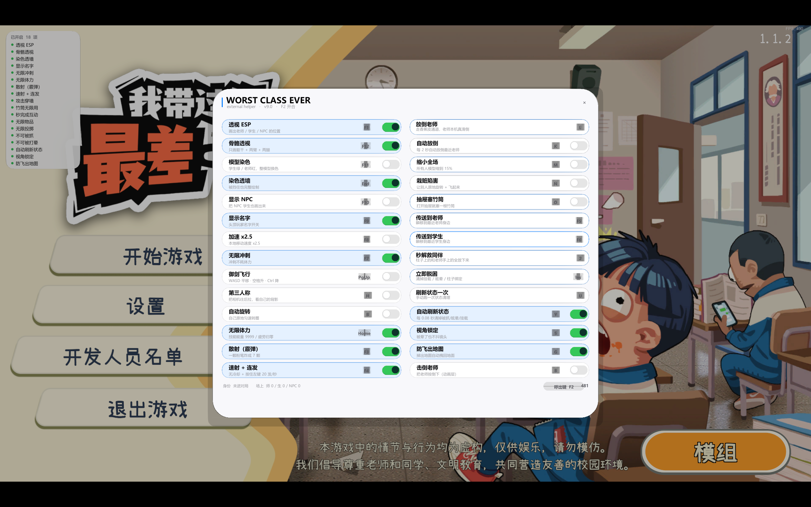

# GS Cheat

《我帶过的最差一届 / Worst Class Ever》的单机 Mod 辅助 —— 走游戏**官方 Mod 系统 + 自带 Harmony**，
不改游戏文件、不改内存、不需要 BepInEx、不受 Steam 文件校验影响。



---

## 特性

两列共 38 项，全部可在面板里鼠标开关，或按热键。

| 视觉 | 移动 | 战斗 | 互动 | 防护 |
|---|---|---|---|---|
| 透视 ESP | 加速 ×2.5 | 散射（霰弹） | 秒完成互动 | 不可被抓 |
| 骨骼透视 | 无限冲刺 | 速射 + 连发 | 无限物品 | 不可被打晕 |
| 模型染色 | 御剑飞行 | 攻击穿墙 | 无限投掷 | 完全隐形 |
| 染色透墙 | 第三人称 | 准星锁定 | 竹筒无限用 | 自动刷新状态 |
| 显示 NPC | 自动旋转 | 刷闪光弹 | 秒解救同伴 | 视角锁定 |
| 显示名字 | 无限体力 | 击倒老师 | 立即脱困 | 防飞出地图 |
|  |  | 放倒老师 / 自动放倒 | 抽屉塞竹筒 | 缩小全场 / 栽赃陷害 |

- **UI**：仿 iOS 白玻璃面板 + 弹簧过渡动画 + 左上角常驻「已开启 N 项」HUD（点哪项哪项亮蓝）
- **菜单键**：默认 <kbd>F2</kbd>，可在面板右下角点「呼出键 F2」后按任意键改绑

---

## 安装

1. 完全退出游戏
2. 双击 `GS-Cheat.exe` → 点「① 部署」
3. 点「③ 启动游戏」（走 Steam 启动，否则会提示「Steam 尚未初始化」）
4. 进游戏按 <kbd>F2</kbd> 呼出面板

启动器会把 `WceHack.dll` + `mod.json` 释放到：

```
<游戏目录>\Mods\wcehack\
```

并修好启用状态文件：

```
%USERPROFILE%\AppData\LocalLow\Funcore Games\Worst Class Ever\Mods\load-order.json
```

> 注意：Mod 包本体必须放在**游戏安装目录**下的 `Mods\`，不是 LocalLow 那个 —— 后者只放 `load-order.json`。

### 手动安装

把 `WceHack.dll` 和 `mod.json` 放进 `<游戏目录>\Mods\wcehack\`，然后确保 `load-order.json` 里有：

```json
{
  "version": 2,
  "sourceChoiceRequired": false,
  "mods": [
    { "id": "wcehack", "enabled": true, "packageKey": "local:wcehack:wcehack", "missing": false }
  ]
}
```

---

## 热键

| 键 | 功能 | 键 | 功能 |
|---|---|---|---|
| F1 | 透视 ESP | F2 | **菜单** |
| F3 | 散射（霰弹） | F4 | 速射 + 连发 |
| F5 | 传送到老师 | F6 | 传送到学生 |
| F7 | 无限冲刺 | F8 | 加速 ×2.5 |
| F9 | 显示名字 | F10 | 显示 NPC |
| F11 | 模型染色 | F12 | 骨骼透视 |
| 1 | 攻击穿墙 | 2 | 秒解救同伴 |
| 3 | 不可被抓 | 4 | 不可被打晕 |
| 5 | 视角锁定 | 6 | 刷闪光弹 |
| 7 | 准星锁定 | 8 | 击倒老师 |
| 9 | 秒完成互动 | 0 | 无限物品 |
| Home | 无限体力 | End | 染色透墙 |
| Ins | 立即脱困 | Del | 完全隐形 |
| PgUp | 御剑飞行 | PgDn | 无限投掷 |
| R | 刷新人物状态 | L | 放倒老师（香蕉皮） |
| K | 自动放倒 | M | 缩小全场 |
| N | 栽赃陷害 | O | 抽屉塞竹筒 |
| T | 竹筒无限用 | U | 刷新状态一次 |
| Y | 自动刷新状态 | G | 防飞出地图 |
| H | 第三人称 | B | 自动旋转 |

---

## 自己编译

需要 .NET Framework 4.x 的 `csc.exe`（Windows 自带，路径
`C:\Windows\Microsoft.NET\Framework64\v4.0.30319\csc.exe`），**不需要装 SDK**。

```powershell
cd mod
powershell -NoProfile -ExecutionPolicy Bypass -File build.ps1
```

`build.ps1` 里改这一行指向你的游戏目录：

```powershell
$Managed = "C:\Program Files (x86)\Steam\steamapps\common\Worst Class Ever\Worst Class Ever_Data\Managed"
```

编译产物是 `mod\WceHack.dll`。

编译启动器：

```powershell
cd launcher
csc /nologo /target:winexe /langversion:5 /optimize+ /out:..\GS-Cheat.exe `
  /win32manifest:app.manifest `
  /resource:payload\WceHack.dll,payload.dll `
  /resource:payload\mod.json,payload.json `
  /r:System.dll /r:System.Core.dll /r:System.Drawing.dll `
  /r:System.Windows.Forms.dll /r:System.Web.Extensions.dll src\Launcher.cs
```

---

## 项目结构

```
mod/src/WceHack.cs      主源码（单文件，C# 5，38 项功能）
mod/ui_glass.cs         Unity 版玻璃 UI 片段（已并入主源码）
mod/build.ps1           编译脚本
launcher/src/Launcher.cs  启动器（WinForms，单文件绿色 exe）
ui/liquid-glass.html      Liquid Glass 风格的 Web 原型（纯 CSS，可直接浏览器打开）
tools/*.ps1 *.py         IL 反汇编 / 交叉引用 / 骨骼扫描等逆向小工具
docs/DEVNOTES.md         开发笔记（接口签名、IL 结论、踩坑记录）
```

## 原理速览

- **加载**：游戏 `WorstClassEver.Modding.ModRuntime` 扫描 `Mods\<id>\mod.json`，
  `Assembly.LoadFrom` 后反射找 `entryType`，要求实现 `WorstClassEver.ModAPI.IMod` 并有无参构造，然后调 `OnLoad(ModContext)`。
- **Hook**：游戏自带 `0Harmony.dll`（且禁止 mod 自带），所以直接 `new HarmonyLib.Harmony("wcehack")` 复用。
- **联机**：这是 Mirror 游戏，多数数值由 host 权威。改本地表现（透视、染色、视角、飞行、UI）完全有效；
  改服务端状态（解柱、放倒他人）要走 `RoomManager.SendToServer<T>` / `BroadcastToAll<T>`。

## License

MIT
